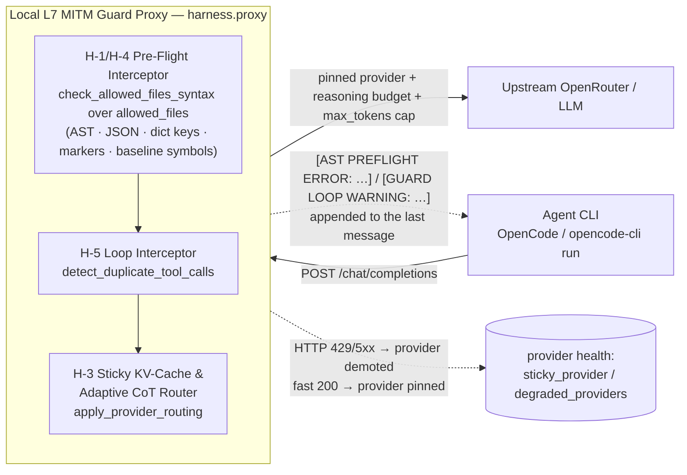

# Harness — Local Guard Proxy for Coding Agents

`agent-harness` is a stdlib-only Python package that sits between a coding-agent
CLI (e.g. OpenCode) and its upstream LLM provider. It exists because production
agent runs fail in four boringly repetitive ways, and every one of them is
cheaper to intercept on the wire than to discover on a bill or in a broken
repository.

## Problem statement

1. **KV-cache churn across upstream providers.** OpenRouter silently re-routes
   retries to a different provider (z-ai → novita → siliconflow). A different
   provider is a different GPU pod and a cold KV cache: every retry re-pays the
   full prompt at cache-miss rates. Provider identity must be pinned
   deliberately, not left to throughput sorting.
2. **Runaway CoT on trivial turns.** A fixed 2k reasoning budget is burned on
   turns where the model only needs to echo "all checks passed" — and is
   simultaneously spent at the default level exactly on the turns that carry an
   error signal and actually need room to reason about a failure.
3. **Silent AST / dict-key corruption.** A Python file with a duplicate dict
   key, leftover merge-conflict markers, or a dropped top-level symbol passes
   the agent's own "I edited the file" belief and fails one CI hop later,
   costing a full pipeline round trip per discovery.
4. **Tool-call loops.** Identical repeated tool calls (same tool, same
   arguments modulo key order/whitespace) mean the agent stopped reading tool
   output. Left alone, this loops until the step or dollar cap.

## Architecture



Every forwarded `/chat/completions` (or `/responses`) request is parsed once,
scanned by the pre-flight and loop interceptors from turn 2, then rebuilt:
notices are appended to the last message, the provider block is rewritten
(sticky pinning / degradation demotion), and the reasoning budget plus
`max_tokens` cap are set for this specific turn. Provider routing runs last so
a notice injected on the same turn immediately activates the error-recovery
budget. Upstream 429/5xx responses arm the circuit breaker
(`degraded_providers`); fast 200s promote the responding provider to
`sticky_provider`.

### Module map

| Module | Responsibility |
| --- | --- |
| `harness.guards` | Pure, stdlib-only helpers: Python/JSON/SQL syntax pre-flight, local-import check, file skeletons, test-failure digests, duplicate tool-call detection, stale-read compaction, wire-level egress guard (`check_egress_payload`), read-only SQL tool guard (`check_readonly_sql_tool_calls`) |
| `harness.routing` | OpenRouter provider preferences, per-model request caps, adaptive reasoning budgets, persistent TTL `ProviderHealthStore`, `vLLM` upstream mode, `small -> teacher` escalation |
| `harness.sandbox` | H-10 sandbox: task-JSON schema + path-boundary validation, exclusive path locks (`file_locked:`), SHA-256 file digests, transactional git worktrees, bounded micro-repair prompts |
| `harness.finops` | H-10 finops: pre-dispatch budget gate (step cap / cost cap / unpriced models), SQLite generation telemetry, local OpenRouter generation settlement, per-task prior-cost aggregation, `export_sml_cost_manifest` |
| `harness.proxy` | `OpenRouterGuardProxy` / `openrouter_proxy` context manager: gate, notices, stale-read compaction, egress & read-only SQL guards, `vLLM` upstream mode, cost & generation-id capture, circuit breaker, span recording |
| `harness.report` | Run-record normalization, benchmark aggregation, Markdown comparison, live state-directory stats, offline A/B replay (`simulate_replay`, `format_replay_markdown`), SML SFT/DPO dataset export (`export_sml_dataset`) |
| `harness.telemetry` | Stdlib-only OpenTelemetry/GenAI tracer, OTLP JSON & Protobuf export (`to_otlp_protobuf`), Arize AX / Phoenix flush, trace-tree rendering |
| `harness.cli` | `preflight`, `skeleton`, `bench-report`, `stats`, `replay`, `trace`, `serve`, `run`, `heal`, `plan`, `export-dataset` subcommands |

H-10 adds the supervisor-side half of the picture. `harness.sandbox`
validates each task manifest against its schema (`task_id`, `directory`,
`files` (1-3 absolute paths), `prompt`, `test_argv` beginning with an
absolute executable) and the workspace path boundary, takes exclusive
`flock`-based file locks so two workers never share canonical paths
(contention fails fast with `file_locked: <path>`), snapshots the pre-edit
SHA-256 digest map, isolates risky edits in a transactional git worktree
that is always removed on exit, and bounds micro-repair by an attempt budget
that reuses the H-2 compact failure digest. The matching `harness.finops`
gate prices the *next* step before it is dispatched — step cap, dollar cap,
unpriced models — settles each OpenRouter generation from the proxy's local
record into SQLite telemetry (`<state-dir>/telemetry.sqlite`), and feeds the
cumulative per-task prior cost back into the gate: an unknown final cost
blocks paid retries instead of silently overshooting.

### Live benchmark — production runs

The guarded path is benchmarked against live production state, not a
synthetic corpus: every supervised run writes a run record under
`<state-dir>/runs/<run>/result.json`, and `harness stats --state-dir …`
(`format_state_stats_markdown`) renders the rolling per-model table plus the
`ALL` aggregate directly from disk.

Snapshot from `harness stats` on 2026-11-16 (**2,081 runs**):

| Model | Runs | Pass@1 (%) | Median Steps | Median Cost (USD) | Total Cost (USD) | Blocked Requests | Auto-Repairs |
| --- | ---: | ---: | ---: | ---: | ---: | ---: | ---: |
| `openrouter/deepseek/deepseek-v4.1-flash-1017` | 423 | 55.6 | 6.0 | 0.0091 | 6.5911 | 0 | 0 |
| `openrouter/moonshotai/kimi-k2.5` | 91 | 20.9 | 4.0 | 0.0000 | 1.2378 | 0 | 0 |
| `openrouter/qwen/qwen3-coder` | 727 | 41.8 | 6.0 | 0.0069 | 8.4045 | 0 | 0 |
| `openrouter/z-ai/glm-5.1` | 22 | 13.6 | 3.0 | 0.0058 | 0.9519 | 0 | 0 |
| `openrouter/z-ai/glm-5.3-flash` | 771 | 53.8 | 4.0 | 0.0036 | 4.0721 | 0 | 0 |
| `unknown` | 47 | 72.3 | 0.0 | 0.0000 | 0.0000 | 0 | 0 |
| **ALL** | **2081** | **48.5** | **5.0** | **0.0052** | **21.2573** | **0** | **0** |

Re-run `harness stats --state-dir …` to refresh these numbers from the live
state directory.

## H-1 — Syntax pre-flight & provider circuit breaker

`harness.guards.check_allowed_files_syntax(files, *, baseline_symbols=None)`
parses each `.py`/`.json`/`.sql` path without spawning a process and returns
positional `path:line: message` errors:

- Python `SyntaxError` (`ast.parse`) — e.g. `bad.py:1: invalid syntax`.
- JSON decode errors (`json.loads`) with the decoder's line number.
- **Duplicate dict keys** — an `ast.Dict` walk keyed on `(type, value)`, so
  `1` and `True` stay distinct; reported at the duplicate key's line
  (`dup.py:3: duplicate dict key 'a'`).
- **Merge-conflict markers** (`<<<<<<< `, `=======`, `>>>>>>> `) at line
  start, in any parseable file type.
- With `baseline_symbols` from `collect_python_top_symbols`, a file that
  drops a previously present top-level function/class is rejected:
  `path:1: dropped top-level symbol(s): keep_one`.

Missing and unreadable paths are skipped; an empty list means clean.

The proxy re-runs the pre-flight over `allowed_files` (with a baseline
captured at construction) on every turn ≥ 2 and injects
`[AST PREFLIGHT ERROR: bad.py:1: invalid syntax — fix before finishing]` into
the last message, so the model sees the failure one turn earlier than CI
would. On the transport side, any upstream `429`/`5xx` adds the responding
provider (from `X-OpenRouter-Provider`, the error body, or the routed
order head) to `degraded_providers` and clears it from `sticky_provider`;
subsequent requests demote it to the back of the order.

## H-2 — Compact test-failure extraction

`harness.guards.extract_compact_test_failure(stdout, stderr, max_lines=25)`
reduces a full pytest log to a bounded digest: lines containing `FAILED`,
`E   ` assertion lines, `SyntaxError` / `ImportError` /
`ModuleNotFoundError` lines — plus **only the last traceback location**
(earlier `File "…", line N` frames are dropped, so the model fixes the
deepest frame, not frame one). Everything else is treated as noise and cut.
If nothing matched, it falls back to the tail of the non-empty output capped
at `min(max_lines, 10)` lines. Output is hard-truncated to `max_lines`, so a
40k-token CI log never reaches the model; the digest feeds micro-repair
prompts such as `[TEST_ARGV FAILURE — fix only the failing assertion/import]`.

## H-3 — Sticky KV-cache pinning & adaptive CoT budget

`harness.routing.apply_provider_routing(body, path, *, turn_index=1,
reasoning_max_tokens=None, degraded_providers=None, sticky_provider=None)`
rewrites the request just before dispatch (only for `/chat/completions` and
`/responses`, and only for models in `MODEL_PROVIDER_PREFS` /
`MODEL_REQUEST_CAPS`):

- **Explicit-order models** (`glm-5.3-flash` → `z-ai, novita, siliconflow,
  gmicloud` with `baseten` ignored; `glm-5.1` → `chutes, z-ai,
  siliconflow`): a healthy sticky provider is moved to
  `provider.order[0]`; a degraded one is demoted to last and never pinned —
  a cold-cache provider must not be retried first.
- **Throughput-sorted models** (DeepSeek FP8 family, `sort: throughput`):
  there is no order list by design; pinning replaces the sort with a
  single-entry `order: [sticky]` and drops `sort`, because a pinned provider
  must stay pinned across turns to keep its KV cache warm.
- **Reasoning budget per turn** (from `turn_index >= LATE_TURN_START == 3`,
  scanning the last two messages for `ERROR_SIGNAL_SUBSTRINGS`):
  - error signal present → `min(2048, 1536)` — recovery level, immediately
    on the turn that carries the signal;
  - clean turn whose last message is a tool result, at `turn_index >= 4` →
    `512` — quiet-turn level, no CoT burn;
  - otherwise → `768` (`LATE_TURN_REASONING_MAX_TOKENS`).
- **Request cap**: `max_tokens` is capped at 8192 per model
  (`MODEL_REQUEST_CAPS`), protecting provider-side quota and implicit KV
  cache.

Turns below the late-turn threshold keep the model default (2048), so early
cheap turns are never inflated.

## H-4 — Semantic AST pre-flight & file skeletons

The duplicate-key, conflict-marker, and dropped-symbol checks in H-1 are the
*semantic* layer of the pre-flight: they catch edits that parse but lie.
`collect_python_top_symbols(files)` builds the `{path: {symbol, …}}`
baseline from whatever currently parses (unparseable `.py` files map to an
empty set, non-`.py` files are omitted), and feeding it back via
`baseline_symbols=` rejects "rename the function and hope" edits.

`harness.guards.build_file_skeletons(files, *, line_threshold=250)` emits a
prompt-ready navigation map for files **longer** than the threshold:

```
[FILE SKELETON MAP -- read only target line ranges]
--- tools/big_module.py (391 lines)
L1-L9: def parse_header(self, stream, strict)
  L11-L24:   def _decode(self, raw)
...
--- tools/query.sql (310 lines)
  L5-L88: CTE monthly_pulse
  L301-L310: final SELECT
```

`.py` files get top-level functions/classes with line spans (`L<start>-L<end>`)
and one level of nested methods; `.sql` files get CTE and final-SELECT ranges.
Short files are skipped — reading them whole is cheaper than reading a map.

## H-5 — Duplicate tool-call loop guard

`harness.guards.detect_duplicate_tool_calls(messages)` compares the last two
assistant tool-call turns; arguments are canonicalized with
`json.dumps(..., sort_keys=True)` (whitespace and key order ignored,
unparseable arguments fall back to their stripped form). A repetition yields
`duplicate tool call edit repeated with identical arguments`; different
arguments or an intervening different tool reset the comparison.

The proxy variant scans the whole conversation (any repeat counts) and, from
turn 2, injects `[GUARD LOOP WARNING: edit called 2x with identical
arguments — change target lines/arguments or finish]`. The notice both
surfaces the loop to the model and — via H-3's error-signal scan — raises the
reasoning budget on that same turn, so the model has budget to change
strategy instead of repeating.

## H-6 — Persistent TTL provider health store

`harness.routing.ProviderHealthStore(path, *, ttl_seconds=600.0)` persists
provider health as JSON (`{"degraded": {provider: expiry_epoch},
"sticky": {model_or_default: {"provider": name, "expiry": expiry}}}`) with
read-modify-write plus atomic temp-file + `os.replace` writes, so restarts
and concurrent workers never observe a half-written store.

- `mark_degraded(provider, now=None)` demotes a provider for the TTL window
  and drops any sticky pin on it (circuit breaker); `set_sticky(provider,
  model=None, now=None)` pins a healthy provider (refused while degraded);
  `get_sticky(model=None, now=None)` and `active_degraded(now=None)` read the
  still-fresh state and prune expired rows. Every method accepts an explicit
  `now=` timestamp, so TTL behavior is testable without sleeping.
- The proxy accepts `OpenRouterGuardProxy(..., health_store=store)`: it
  hydrates `degraded_providers` / `sticky_provider` at construction and
  records every demotion / pin through the store. A **second proxy instance**
  (restarted CLI, next agent session) therefore inherits the warm-KV pin and
  the circuit-breaker demotions instead of re-paying a cold cache on a
  provider that just failed. Entries expire after
  `DEFAULT_PROVIDER_HEALTH_TTL_SECONDS = 600` in both directions: a sticky
  pin ages out so throughput sorting can resume, and a degraded provider
  recovers so it can be retried.

## H-7 — SQL/Jinja & local-import static pre-flight

`harness.guards.check_sql_syntax(text, filename="<sql>")` pre-flights a
dbt-style SQL/Jinja template without spawning a process. It masks `--` line
comments, `/* ... */` block comments, single-quoted strings (with `''`
escapes), and Jinja `{{ ... }}` / `` regions, then reports:

- unbalanced parentheses (`q.sql:1: unbalanced parenthesis`);
- trailing commas before `FROM` / `WHERE` / `GROUP BY` / `ORDER BY` /
  `HAVING` / `LIMIT` / `UNION` (`q.sql:1: trailing comma before FROM`);
- unclosed comments or string literals; and
- unbalanced Jinja statement tags (`if`/`endif`, `for`/`endfor`,
  `macro`/`endmacro`) at the opening tag's line.

It is wired into `check_allowed_files_syntax`, so every `.sql` allowed file
gets the same zero-shell treatment as `.py`/`.json`. The H-7 pre-flight also
catches broken **local imports** statically: `from <sibling> import <missing>`
is rejected by parsing the sibling module next to the importing file and
checking the name against everything the sibling defines, assigns, imports,
or exports via `__all__` (`importer.py:1: cannot import name 'missing_name'
from 'helper'`). Nothing is executed; unparseable siblings are skipped.

## H-8 — Threshold stale-read observation compaction

`harness.guards.compact_stale_reads(messages, *, turn_index=1, min_turn=5,
char_threshold=400)` shrinks the context tax of stale observations. It maps
`tool_call_id` → `(tool_name, file_path)` (arguments scanned for `path`-style
keys), records the last message index at which each file was touched by an
edit/write/patch tool, and replaces every **earlier** read/view result on
that path longer than `char_threshold` with
`[STALE READ COMPACTED: {path} was modified in a later turn — re-read target
lines if needed]`. OpenAI-style `tool_calls` and Anthropic-style
`tool_result` blocks are both handled; the input list is never mutated; and
below `min_turn` everything passes through untouched.

The proxy runs compaction on every forwarded request from turn 5, before
provider routing, and increments `proxy.summary()['compacted_reads']`; a
`guard.stale_read_compaction` GUARDRAIL span records each compaction event.

## H-9 — Live state telemetry & CLI stats

`harness.report.scan_state_runs(state_dir)` scans a live state directory:
every `<state_dir>/runs/<run>/result.json` (oldest-first by run-directory
mtime) is normalized via `summarize_run`, with the run's optional sibling
`requests.json` guard-proxy telemetry folded in as `proxy_summary`.
`format_state_stats_markdown(state_dir)` renders a per-model table (runs,
Pass@1, median steps/cost, total cost, blocked requests, auto-repairs) with
a trailing `ALL` row; a missing or empty `runs/` yields `No runs found.`.

```console
$ harness stats --state-dir ~/.tools/opencode-guard-state   # Markdown stats table
$ harness trace ~/.tools/opencode-guard-state/runs/<run>    # trace tree from traces.jsonl
$ harness trace path/to/traces.jsonl                        # ...or an explicit file
```

## H-10 — Sandbox Isolation, FinOps & Small Model Lab Integration

H-10 pairs supervisor-side isolation and cost accounting with wire-level
guardrails for `Small Model Lab` distillation and eval rollouts:

- **Sandbox isolation (`harness.sandbox`)**: Validates task manifests and
  workspace path boundaries, acquires exclusive `flock` path locks, snapshots
  SHA-256 file digests, runs edits inside transactional git worktrees that are
  always cleaned up on exit, and bounds micro-repair loops with compact failure
  digests.
- **FinOps & cost settlement (`harness.finops`)**: Enforces pre-dispatch step
  and dollar caps, settles per-generation costs from proxy telemetry into
  SQLite (`<state-dir>/telemetry.sqlite`), aggregates cumulative prior cost per
  task (correlating `X-Harness-Task-Id` headers), and exports Small Model Lab
  cost manifests via `export_sml_cost_manifest`.
- **CLI subcommands (`harness serve`, `harness run`)**:
  - `harness serve`: Runs the local MITM guard proxy as a standalone HTTP
    endpoint (supporting `HARNESS_BASE_URL` clients such as `Small Model Lab`'s
    `GatewayConfig`).
  - `harness run`: Executes a supervised task manifest end-to-end with
    sandboxed worktree isolation, FinOps budget gating, and proxy telemetry.
- **Wire-level guards & SML rollout routing (`harness.guards`, `harness.proxy`, `harness.routing`)**:
  - **Egress guard (`check_egress_payload`)**: Inspects outbound request
    payloads on the wire to block forbidden raw-body, credential, or secret
    fields before they leave the local boundary.
  - **Read-only SQL tool guard (`check_readonly_sql_tool_calls`)**: Enforces
    read-only SQL constraints on tool calls so exploratory database queries
    cannot mutate state.
  - **`vLLM` upstream mode**: Routes requests to a local/self-hosted `vLLM`
    OpenAI-compatible endpoint when configured instead of OpenRouter.
  - **`small -> teacher` model escalation**: Automatically escalates failed or
    low-confidence small-model rollouts to a designated teacher model under the
    same FinOps budget and trace context.

## H-11 — Context-window compaction (`compact_context_window`)

`harness.guards.compact_context_window(messages, *, max_context_tokens=6000)`
bounds prompt growth on long multi-turn runs by compacting older observations
and trimming excess context once the estimated token count exceeds
`max_context_tokens`. In `harness serve`, `--max-context-tokens` configures the
live proxy budget so long tool-use trajectories stay within model context and
KV-cache limits.

## H-12 — Per-task SML accounting (`X-Harness-Task-Id`)

Requests carrying the `X-Harness-Task-Id` header are correlated in
`harness.finops` and `harness.proxy` so per-generation token usage and USD cost
roll up accurately by task ID. Passing `--sml-results-dir` exports and reconciles
per-task Small Model Lab (SML) cost manifests alongside local SQLite telemetry.

## H-13 — Offline A/B replay simulator (`harness replay`)

`harness.report.simulate_replay(records_or_state_dir, *, max_context_tokens=6000,
fallback_teacher_model=None, upstream_mode="openrouter")` replays recorded
episodes (from a JSON/JSONL file or a live `state_dir`) through
`detect_duplicate_tool_calls`, `check_readonly_sql_tool_calls`,
`compact_context_window`, and `apply_provider_routing` without making upstream
network calls. `format_replay_markdown(summary)` renders the aggregated metrics
(`total_episodes`, `loop_warnings_triggered`, `sql_violations_caught`,
`escalated_to_teacher_count`, `tokens_before`, `tokens_after`, `tokens_saved`,
`token_reduction_pct`):

```console
$ harness replay --input episodes.jsonl --max-context-tokens 6000
$ harness replay --state-dir state/ --fallback-teacher-model openrouter/deepseek/deepseek-v4.1-flash-1017 --json
```

## H-14 — Zero-dependency OTLP Protobuf exporter (`to_otlp_protobuf`)

`HarnessTracer.to_otlp_protobuf()` encodes recorded OpenInference/GenAI spans
into standard binary OTLP/HTTP `ExportTraceServiceRequest` protobuf wire bytes
using only the Python standard library (no `opentelemetry-*` or `protobuf`
packages required), enabling native binary ingestion into Arize Phoenix and
other OTLP protobuf collectors.

## OpenTelemetry GenAI + Arize AX / Phoenix OpenInference tracing

`harness.telemetry.HarnessTracer` is a stdlib-only tracer speaking both
attribute dialects: every span carries `openinference.span.kind`
(validated against `OPENINFERENCE_SPAN_KINDS`: `AGENT`, `LLM`, `GUARDRAIL`,
`CHAIN`, `TOOL`) plus `openinference.project.name` on top of `gen_ai.*`,
`llm.*`, `guardrail.*`, and `harness.*` keys, so the same stream is
first-class in Arize AX, Phoenix, and any GenAI-semantics consumer.

- The guard proxy records a `gen_ai.chat` **LLM span** per forwarded request
  (system, model, provider, generation id, stream cost, turn index, applied
  reasoning budget, HTTP status) and **GUARDRAIL spans** for every
  pre-flight error, loop warning, stale-read compaction, and circuit-breaker
  demotion; `proxy.summary()['spans']` exposes them for run records.
- `tracer.record_span(name, kind=..., parent_span_id=..., attributes=...)`
  appends in-memory and (optionally) to a JSONL file (`jsonl_path=`), which
  is exactly the `traces.jsonl` the `harness trace` command renders via
  `format_trace_tree`.
- `tracer.to_otlp_payload()` converts recorded spans into OTLP/HTTP JSON
  `ExportTraceServiceRequest` (`resourceSpans` → `scopeSpans` → `spans`,
  proto3-JSON int64 nanos, 32/16-hex trace/span ids);
  `tracer.flush_otlp(endpoint=...)` POSTs it and returns `True` on 2xx
  (never raises), attaching Arize authentication headers.

Environment variables (all optional; constructor arguments win):

| Variable | Meaning |
| --- | --- |
| `ARIZE_COLLECTOR_ENDPOINT` | Arize AX OTLP collector; highest endpoint precedence |
| `PHOENIX_COLLECTOR_ENDPOINT` | Phoenix OTLP collector; second precedence |
| `OTEL_EXPORTER_OTLP_ENDPOINT` | Generic OTLP endpoint; last precedence |
| `ARIZE_API_KEY` | Sent as `api_key` / `x-arize-api-key` headers on flush |
| `ARIZE_SPACE_ID` | Sent as `space_id` / `x-arize-space-id` headers on flush |
| `ARIZE_PROJECT_NAME` / `PHOENIX_PROJECT_NAME` | `openinference.project.name` (default `agent-harness`) |

## Report & CLI

`harness.report.summarize_run` normalizes raw runner JSON (tolerant of
`cost`/`cost_usd`, `steps`/`model_steps`, `passed`/`succeeded`/… spellings);
`aggregate_benchmark_runs(runs)` folds that into `total_runs`, `pass_count`,
`pass_rate`, `median_steps`, `median_cost_usd`, `total_cost_usd`, and
`micro_repair_count`; `format_benchmark_markdown(baseline_runs,
guarded_runs)` renders a baseline-vs-guarded comparison table.

```console
$ harness preflight src/a.py src/conf.json          # exit 1 on any finding
$ harness skeleton big.py --threshold 100           # print the L<start>-L<end> map
$ harness bench-report --baseline runs.json --guarded guarded.json
$ harness stats --state-dir state/ --insights       # live stats + failure insights (H-28)
$ harness replay --state-dir state/                 # offline A/B replay simulation
$ harness trace state/runs/<run>/traces.jsonl       # OpenInference trace tree
$ harness trace --sync-state state/                 # backfill runs to Phoenix OTLP (H-20)
$ harness rollout task.json --group-size 4          # group rollouts for GRPO / rejection sampling (H-73)
$ harness export-dataset --state-dir state/ --mode sft --clean-only --max-steps 6 --output sft.jsonl
$ harness export-dataset --state-dir state/ --mode repair-sft --output repair_sft.jsonl   # Tenet self-repair SFT (H-88)
$ harness stats --state-dir state/ --insights --days 7   # 7-day rolling window & funnel (H-77)
$ harness pod preflight --pods root@gpu-1:22             # cloud GPU pod SSH orchestration (H-78)
$ harness herdr status --state-dir state/                # Herdr multiplexer dashboard & actions (H-78)
$ pytest -q tests/test_harness.py                   # contract suite
```

## Capabilities H-15 .. H-88

| ID | Capability | Module |
| --- | --- | --- |
| **H-15..H-18** | Salvage validation on `step_limit`/`worker_timeout`, adaptive micro-repair pass, edit-mismatch recovery hints, OpenInference `TOOL` spans | `sandbox.py`, `guards.py`, `telemetry.py` |
| **H-19..H-22** | Telemetry test isolation, Phoenix state trace backfill (`--sync-state`), `read_only_files` integrity guard, unindexed-read guard hints | `telemetry.py`, `sandbox.py`, `guards.py` |
| **H-23..H-25** | Symlink path canonicalization & prompt alias rewriting, adaptive micro-repair steps (`compute_repair_max_steps`), JSON parse error recovery | `sandbox.py`, `routing.py`, `guards.py` |
| **H-26..H-28** | Preloaded file excerpts (`build_preloaded_file_excerpts`), prior attempt feedback (`build_prior_attempt_feedback`), state failure insights (`compute_state_insights`) | `guards.py`, `sandbox.py`, `report.py` |
| **H-29** | Full proxy wiring in `run_task` (`ProviderHealthStore`, `max_context_tokens`, `fallback_teacher_model`, egress/SQL guards, `upstream_mode`) + `TEACHER_MODELS` allowlist | `sandbox.py`, `routing.py` |
| **H-30** | Moonshot/Kimi-style KV-cache prefix stability: epoch-gated `compact_stale_reads` with `keep_recent_turns` and `min_total_saved_chars` threshold | `guards.py`, `proxy.py` |
| **H-31** | MiniMax/DeepSeek `SWE-Pruner` Lite: in-proxy `prune_noisy_tool_outputs` compacting bloated pytest/traceback tool results before context-window compaction | `guards.py`, `proxy.py` |
| **H-32** | Z.ai-style edit-oscillation & plateau guard (`detect_edit_oscillation`: `revert_cycle` A→B→A and `untested_edit_streak`) wired into `ERROR_SIGNAL_SUBSTRINGS` | `guards.py`, `proxy.py`, `routing.py` |
| **H-33** | `TrajSpec` retry distillation: Python AST symbol-level `before`/`after` diff and guardrail event summary prioritized in `build_prior_attempt_feedback` | `sandbox.py` |
| **H-34** | DeepSeek R1 / SWE-Gym verifier-guided `best_of_2` strategy (`run_best_of_2`, `candidate_models`) with file snapshot/restore and early exit on clean pass | `sandbox.py` |
| **H-35** | Kimi / ZCode-style learned repo memory hints (`build_repo_memory_hint`, `include_repo_memory`) auto-injected from recurring workspace block reasons and tool errors | `report.py`, `sandbox.py` |
| **H-36** | Targeted edit & tool-error recovery hints (`inject_edit_failure_hints`: no-op `oldString == newString`, ambiguous multi-match with on-disk `L<n>` lines, unknown tool name) | `guards.py` |
| **H-37** | Read-only excerpt preloading (`build_preloaded_file_excerpts` symbol windows + `READ-ONLY` header) and preloaded permission-denied stop hint (`inject_read_guard_hints`) | `guards.py`, `sandbox.py` |
| **H-38** | In-proxy per-attempt timeout & immediate healthy-provider failover on `TimeoutError` / `socket.timeout` (`_OpenRouterProxyHandler`) | `proxy.py` |
| **H-39** | Default heterogeneous `best_of_2` cascade (`glm-5.3-flash` → `deepseek-v4.1-flash-1017`) and cross-candidate `[CANDIDATE_1_TRAJSPEC_FEEDBACK]` handoff | `sandbox.py` |
| **H-40** | Fuzzy `oldString` mismatch recovery hint (`_fuzzy_mismatch_hint` via `difflib.SequenceMatcher` closest on-disk `L<a>-L<b>` window & already-applied `newString` detection) | `guards.py` |
| **H-41** | Zero-read micro-repair context (`build_micro_repair_prompt` with `[TRAJSPEC_MODIFIED_SYMBOLS]`, `[CURRENT_ON_DISK_EXCERPTS]`, and traceback line-number extraction) | `sandbox.py`, `guards.py` |
| **H-42** | Recoverable-failure auto-escalation (`ESCALATABLE_BLOCK_REASONS`, `auto_escalate`, `harness run --best-of-2`) skipping Candidate 2 on fatal lock/budget/config blocks | `sandbox.py`, `cli.py` |
| **H-43** | Zero-read fast path: AST/symbol window preloading for long editable files (`_symbol_line_windows`), `COMPLETE FILE PRELOADED` header, and redundant-read guard hint | `guards.py` |
| **H-44** | Small Model Lab SFT & DPO trajectory dataset exporter (`export_sml_dataset`, `harness export-dataset --mode sft\|dpo`) | `report.py`, `cli.py` |
| **H-45** | Micro-repair salvage validation on `step_limit`/`worker_timeout` (`salvaged_from = micro_repair_<reason>`) and `OpenRouterGuardProxy.reset_session()` | `sandbox.py`, `proxy.py` |
| **H-46** | Cross-file dotted package & relative `ImportFrom` symbol pre-flight (`_resolve_importfrom_target`, `_sibling_import_errors` across `known_files`) | `guards.py` |
| **H-47** | Failing pytest source excerpt & nodeid injection into `build_micro_repair_prompt` (`extract_failing_test_excerpts`, `[FAILING_TEST_CONTEXT]`) | `guards.py`, `sandbox.py` |
| **H-48** | Global `HARNESS_AUTO_ESCALATE` env toggle (`should_auto_escalate`) and `micro_repair_no_change` redundant test-run skip | `sandbox.py` |
| **H-49** | Golden-trajectory SFT/DPO dataset filter (`--clean-only`, `--max-steps`, `_is_clean_sft_run` excluding guard-intervened/repaired runs) | `report.py`, `cli.py` |
| **H-50** | Expanded post-edit salvage validation (`SALVAGEABLE_BLOCK_REASONS` adding `repeated_tool_error`, `repeated_file_read_without_write`, `model_error`) across primary & micro-repair runs | `sandbox.py` |
| **H-51** | Workspace `.venv` pytest auto-resolution & pre-flight runner check (`resolve_pytest_test_argv`, `test_runner_missing_pytest`) | `sandbox.py` |
| **H-52** | Enclosing `TestClass` header, `setUp`/`setUpClass`, and fixture context in `extract_failing_test_excerpts` for class-scoped test failures | `guards.py` |
| **H-53** | `TrajSpec` on-disk line-range annotations (`_python_symbol_spans`, `sym (L<a>-L<b>)`) and automatic excerpt seeding for modified/added symbols in `build_micro_repair_prompt` | `sandbox.py` |
| **H-54** | Test state isolation in `TestH42AutoEscalation` and ephemeral temporary test-run cleanup (`purge_ephemeral_test_runs`) | `report.py`, `test_harness.py` |
| **H-55** | Turn-deduplicated distinct-input tool error accounting and completed-edit error counter reset in `finops.metrics` | `finops.py` |
| **H-56** | Two-stage fast-fail pytest verification by failing nodeids after `micro_repair` (`build_targeted_pytest_argv`, `micro_repair_fast_fail`) | `sandbox.py` |
| **H-57** | Retroactive post-edit salvage backfill for historical passing runs (`backfill_salvaged_runs`, `harness stats --backfill-salvage`) | `report.py`, `cli.py` |
| **H-58** | Explicit allowed-files allowlist and denied-path reporting in `Permission denied: read` guard hint (`_extract_allowed_read_paths_from_prompt`) | `guards.py` |
| **H-59** | Bounded proportional wall-clock timeout for `micro_repair` (`compute_repair_timeout_seconds`, `active_timeout_seconds`) | `sandbox.py` |
| **H-65** | Local import companion inference (`infer_read_only_companion_files` second pass parsing `Import`/`ImportFrom` of editable `.py` files) and worktree path aliases (`file_aliases` / `read_only_file_aliases` merging original repo paths in `isolated_worktree`) | `sandbox.py` |
| **H-66** | Parallel worktree DAG plan executor (`validate_plan`, `execute_plan`, `harness plan [--validate-only] [--state-dir]` CLI): validates wave/task DAG manifests and executes them with wave-parallel workers | `sandbox.py`, `cli.py`, `__init__.py` |
| **H-67** | Cross-file symbol context preloading (`build_cross_file_symbol_context`: AST-derived imported symbol signatures, class/dataclass fields, UPPER_CASE constants, and `conftest.py` pytest fixture broker) gated by the `include_symbol_context` task flag | `guards.py`, `sandbox.py` |
| **H-68** | Autonomous Pytest Failure Healer (`synthesize_heal_task`, `heal_directory`, `harness heal` CLI): synthesizes a task from a failing pytest invocation, optionally edits tests, isolates risky edits in a transactional worktree, and reports structured heal results | `sandbox.py`, `cli.py`, `__init__.py` |
| **H-69** | Extended Small Model Lab dataset export modes (`export_sml_dataset`, `harness export-dataset --mode sft\|dpo\|sft-chat\|grpo\|probes`) with `assistant_turn_mask`, gated multiplicative GRPO rewards & group advantages, and Lancet contrastive probe pairs | `report.py`, `cli.py` |
| **H-70** | Full `sml.tracking.cost.CostRecord` 12-field compatibility in `export_sml_cost_manifest` and `X-SML-Task-Id` / `X-SML-Request-Id` (`<scenario>-step-<N>`) task routing in `OpenRouterGuardProxy` | `finops.py`, `proxy.py` |
| **H-71** | Native `Tenet` / `Small Model Lab` model routing (`TENET_PROVIDER_ROUTING`, `is_local_or_sml_model`, `upstream_mode="llamacpp"`) and `check_cot_and_slop_integrity` (`<think>...</think>` unclosed/collapse & slop prefix warnings) | `routing.py`, `guards.py` |
| **H-72** | In-proxy `check_cot_and_slop_integrity` enforcement (`cot_slop_warnings`, OpenInference `GUARDRAIL` `cot_slop_integrity` spans) and `$0` API-cost billing gate for local/SML models (`vllm`, `llamacpp`, `tenet-*`, `sml-*`) | `finops.py`, `proxy.py` |
| **H-73** | Group rollout runner (`run_group_rollout`, `harness rollout <task.json> --group-size G`) for On-Policy GRPO and Teacher Rejection Sampling with snapshot/worktree isolation, multiplicative rewards, group-normalized advantages, and best-patch restoration | `sandbox.py`, `cli.py`, `__init__.py` |
| **H-74** | FinOps no-edit stall, windowed-read & recoverable edit-error guards (`window_reads`, `recoverable_errors`, `steps_since_last_edit`, `reasoning_only_streak` -> `reasoning_stall_no_tool_call`) | `finops.py` |
| **H-75** | In-loop `.opencode/plugin/harness_guard.ts` TypeScript guard plugin (`py_compile`/JSON check + near-matching `oldString` line hints) and per-run `/tmp/hb-<hash12>` sandbox isolation (`render_guard_plugin`, `stage_isolation_sandbox`) | `sandbox.py` |
| **H-76** | Contrastive Workspace Lessons Library (`record_repair_lesson`, `load_workspace_lessons`, `lessons.jsonl`) auto-capturing repair signatures and injecting `### Workspace Guardrails (from prior repairs)` into retries | `sandbox.py` |
| **H-77** | Time-windowed `--days` stats filtering, 7-day rolling funnel (`_recent_7d_insights`), active vs. stale (`>7d`) unresolved task split, and `zero_edit_failed_runs` telemetry | `report.py`, `cli.py` |
| **H-78** | Cloud Pod SSH orchestration (`harness pod {preflight,sync,launch,wait}`) and native Herdr terminal multiplexer integration (`harness herdr`, OSC 7501 sequences, JSON-lines Unix socket, `herdr-plugin.toml`) | `pod.py`, `herdr.py`, `cli.py` |
| **H-79** | Auto-include ancestor `conftest.py` files for test targets (`infer_read_only_companion_files`) and emit in-loop `[HARNESS READ GUARD]` allowed-files hints on `Permission denied` in `harness_guard.ts` | `sandbox.py` |
| **H-80** | Exact multi-match line-range disambiguation (`L<start>-L<end>` + ±3 context lines) for `Found N matches` edit failures in `render_guard_plugin` | `sandbox.py` |
| **H-81** | Egress guard false-positive prevention: multiline base64 PEM key matching in `_CREDENTIAL_PATTERNS` and automatic `262_144`-byte pre-compaction (`enforce_context_budget`) in `OpenRouterGuardProxy` | `guards.py`, `proxy.py` |
| **H-82** | Retroactive workspace lessons backfill (`backfill_repair_lessons`, `harness stats --backfill-lessons [--dry-run]`) scanning historical `micro_repair` runs | `report.py`, `cli.py`, `__init__.py` |
| **H-83** | High-signal actionable workspace lessons: pytest noise/progress filter in `_lesson_error_signature`, `/.worktrees/` path normalization + relative-file matching, `changes.patch` `-> Fix:` summary (`_extract_patch_fix_summary`), and `rc=4` renamed-nodeid fallback in `micro_repair` | `sandbox.py`, `report.py` |
| **H-84** | Project- & submodule-aware workspace identity (`resolve_project_identity`) isolating Work monorepos (`medvidi/analytics-gitops`, `medvidi/analytics-airflow-app` with `ai/serving`, `ai/local_copilot`, `airflow/dags` submodule tiers), Personal repos (`personal/harness`, `personal/herdr`), and `Small Model Lab` / `Tenet` (`personal/small-model-lab`) across `load_workspace_lessons` and `build_repo_memory_hint` | `sandbox.py`, `report.py` |
| **H-85** | Cursor/Aider-style in-loop indentation-normalized auto-apply for `Could not find oldString` edit failures in `harness_guard.ts` with `py_compile`/`JSON.parse` validation and automatic rollback on syntax error (`render_guard_plugin`) | `sandbox.py` |
| **H-86** | Claude Code / OpenHands-style in-loop stdlib `ast` undefined-name semantic linter (`check_python_undefined_names` + `[HARNESS IN-LOOP SEMANTIC LINT]` after `py_compile` in `harness_guard.ts`) | `guards.py`, `sandbox.py` |
| **H-87** | OpenHands / SWE-RL mid-run zero-edit read-stall nudge (`detect_zero_edit_read_stall`, `[HARNESS FORCE-EDIT DEADLINE]`, `guard.zero_edit_stall_nudge` span, and `reasoning_max_tokens <= 256` clamp on `turn_index >= 3`) | `guards.py`, `proxy.py` |
| **H-88** | Qwen3-Coder / SWE-Gym intra-run `micro_repair` DPO (`pair_source="intra_run_micro_repair"` vs `"cross_run_retry"`) and `repair-sft` dataset export (`harness export-dataset --mode repair-sft`) for `Tenet` self-repair training | `report.py`, `cli.py` |

## Quickstart

```python
import json
from harness import OpenRouterGuardProxy
from harness.routing import apply_provider_routing

# In-process routing without a socket:
body = json.dumps({"model": "openrouter/z-ai/glm-5.3-flash",
                   "messages": [{"role": "user", "content": "hi"}]}).encode()
routed = apply_provider_routing(body, "/chat/completions", turn_index=1,
                                sticky_provider="siliconflow")

# Or run the proxy and point the agent CLI at it:
proxy = OpenRouterGuardProxy(lambda: None, allowed_files=["src/a.py"])
print(proxy.base_url)   # e.g. http://127.0.0.1:52133/api/v1
# with openrouter_proxy(gate, allowed_files=files) as proxy: ...
```

The `gate` callable returns a stop reason (truthy) to block dispatch and
return `429 guard_stop` — that is the supervisor's budget/deadline hook.
No third-party dependencies: Python ≥ 3.10 standard library only.

```console
$ pytest -q tests/test_harness.py    # H-1..H-59 contract suite (180 unittest/pytest cases)
```
